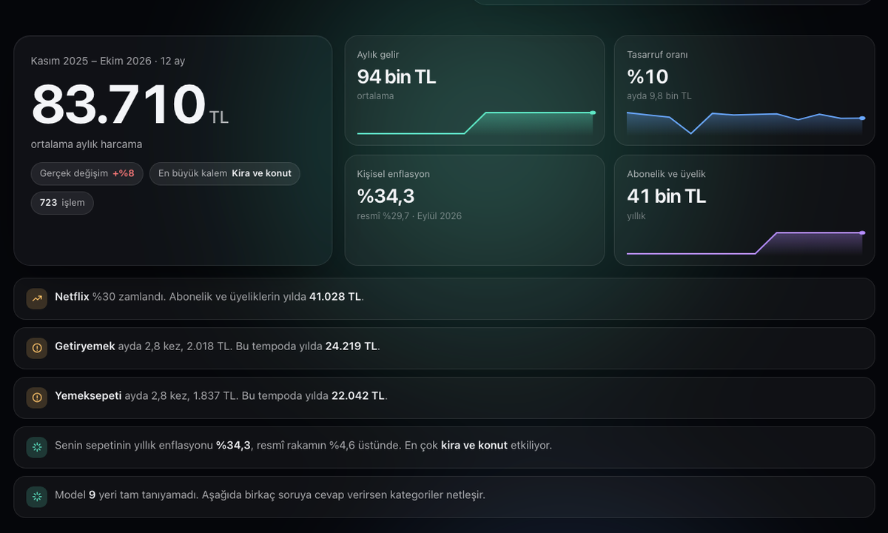
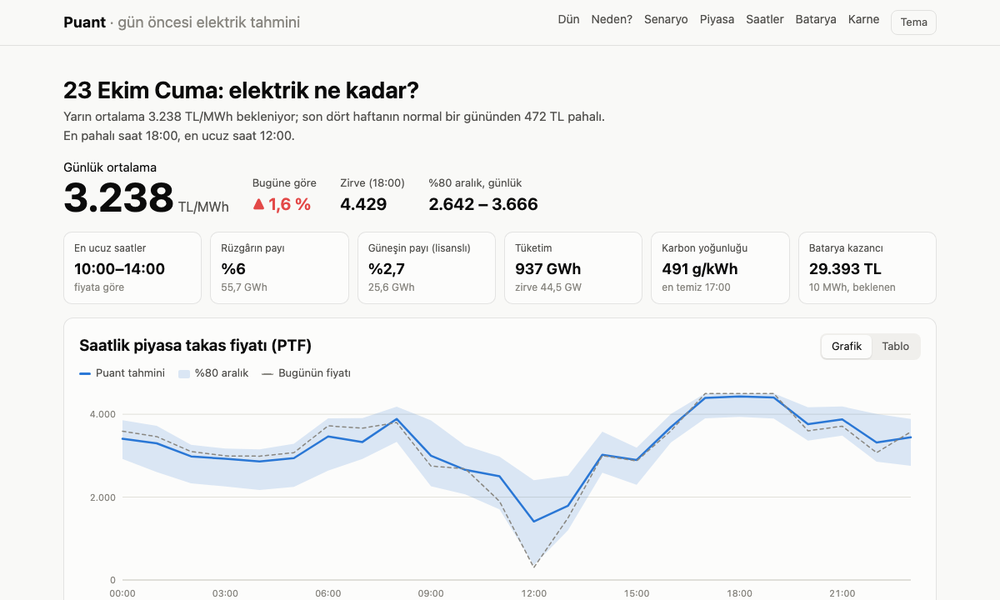
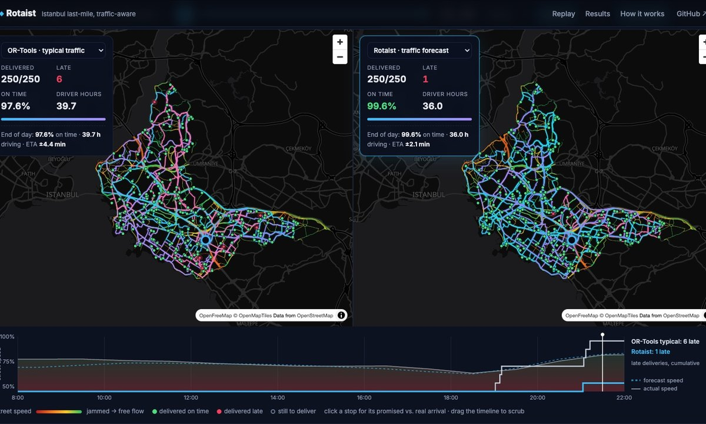
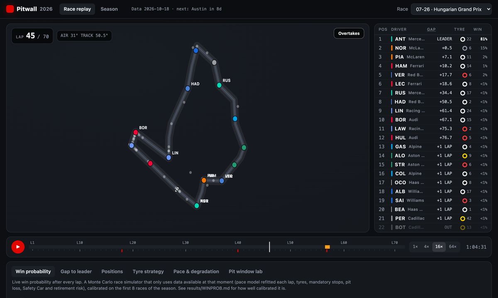
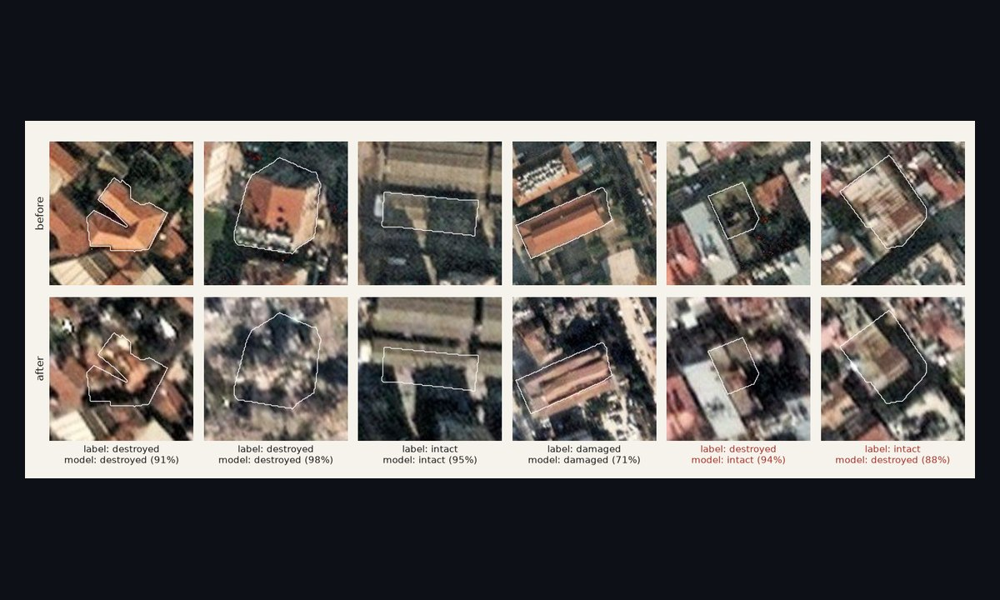
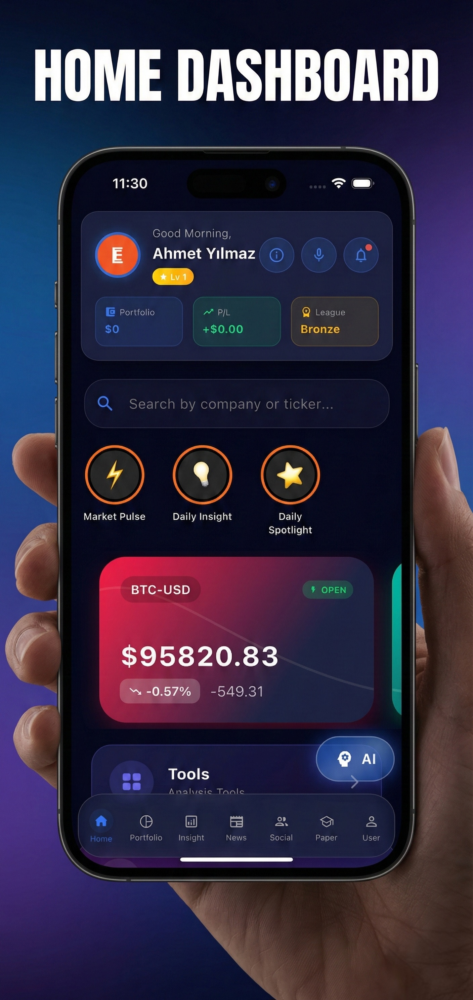

<picture>
  <source media="(prefers-color-scheme: dark)" srcset="assets/svg/header-dark.svg">
  
</picture>

  
  
  

## About

<picture>
  <source media="(prefers-color-scheme: dark)" srcset="assets/svg/about-dark.svg">
  
</picture>

I like problems where the data is messy and the answer has to be right: tomorrow's electricity price, a delivery van in Istanbul traffic, a collapsed building in a satellite image, a bank statement full of shop names nobody has labelled.

My loop is usually the same. I find a public data source that nobody has cleaned up yet (EPİAŞ, İBB, KAP, Eurostat, OpenF1), build a model, and test it on data it has never seen against the best baseline that already exists. Then I ship it as something you can open in a browser, with a daily pipeline that keeps it current. Every README says where the model falls short, because a number you cannot check is not worth much.

I graduated first in my faculty at Istanbul Ticaret University, and I have shipped a market analysis app to the App Store.

<table>
<tr>
<td valign="top" width="33%"><b>Models</b> forecasting · probabilistic & calibrated outputs · Monte Carlo · naive Bayes · CNNs · RAG</td>
<td valign="top" width="33%"><b>Data</b> Turkish open data · geospatial · time series · PDF and table extraction · daily pipelines</td>
<td valign="top" width="33%"><b>Product</b> dependency-free web apps · SVG charts · PWAs · Flutter · FastAPI · CI and tests</td>
</tr>
</table>

## Selected work

<table>
<tr>
<td width="50%" valign="top">

<h3><a href="https://github.com/emrtunali/kumbara">Kumbara</a></h3>
<b>PERSONAL FINANCE · ON-DEVICE ML</b>

Bank statement analysis that never leaves the browser. A naive Bayes model trained in the browser categorises local shops that brand rules miss, and asks when it is unsure.

<b>14 % → 79 %</b> correct on 121 unseen merchants · <b>97 %</b> precision when it commits · personal inflation · savings planner

 
</td>
<td width="50%" valign="top">

<h3><a href="https://github.com/emrtunali/puant">Puant</a></h3>
<b>ENERGY MARKETS · FORECASTING</b>

Day-ahead probabilistic forecasts of Turkish electricity prices, demand, wind, solar and carbon, with Shapley explanations and an auction simulator on EPİAŞ's real bids.

Beats TEİAŞ's load plan by <b>25 %</b> and EPİAŞ's wind forecast by <b>34 %</b> · a battery on it earns <b>82 %</b> of perfect foresight

 
</td>
</tr>
<tr>
<td width="50%" valign="top">

<h3><a href="https://github.com/emrtunali/rotaist">Rotaist</a></h3>
<b>LOGISTICS · OPTIMISATION</b>

Tomorrow's street-level traffic forecast from İBB open data, fed into a time-dependent ALNS optimiser written from scratch, then driven on the traffic that really happened.

<b>10–17 % fewer driver hours</b> than Google OR-Tools at the same punctuality · traffic error <b>3.5 km/h</b> vs 9.3

 
</td>
<td width="50%" valign="top">

<h3><a href="https://github.com/emrtunali/pitwall">Pitwall</a></h3>
<b>SPORTS ANALYTICS · SIMULATION</b>

Every 2026 Formula 1 race rebuilt from raw timing data, with a live win probability, a strategy simulator and a tyre model. It updates itself after every race.

Tyre model <b>28 % lower error</b> than a flat-pace baseline on 9 unseen races · <b>380 / 380</b> championship points reconciled

 
</td>
</tr>
<tr>
<td width="50%" valign="top">

<h3><a href="https://github.com/emrtunali/enkaz">Enkaz</a></h3>
<b>COMPUTER VISION · DISASTER RESPONSE</b>

Building-level damage from pre- and post-event satellite images of the 6 February 2023 earthquakes, tested on Antakya, a city kept out of training entirely.

The top 10 % of its ranking finds <b>51–55 %</b> of destroyed buildings (10 % for a change score) · calibrated probabilities

 
</td>
<td width="50%" valign="top">

<h3><a href="https://github.com/emrtunali/kap-analyst">KAP Analyst</a></h3>
<b>LLM AGENTS · RETRIEVAL</b>

Answers questions about Borsa İstanbul companies from their KAP filings, with page-level citations. Ratios come from extracted statement values, never from model arithmetic.

Retrieval Hit@5 <b>0.912</b> (BM25 alone 0.692) · Turkish questions <b>0.961</b> · <b>90 / 90</b> statement values exact

</td>
</tr>
</table>

## Shipped

<table>
<tr>
<td width="190" valign="top"></td>
<td valign="top">
<h3><a href="https://apps.apple.com/tr/app/finsight-pro-simulation/id6757315007?l=tr">FinSight Pro Simulation</a></h3>
<b>iOS · ANDROID · ON THE APP STORE</b>

Market analysis and paper trading. A Flutter client and a FastAPI backend with real-time WebSocket market data, portfolio risk and diversification analytics, ML and LLM market insights, and PDF reports. Educational simulation, no real money.

   
</td>
</tr>
</table>

## Tools

  

## Experience

**Software Testing Intern · EGEMSOFT / Türk Telekom** 
Performance testing with JMeter, Oracle database testing, found critical deployment issues, built a data mining demo in Python.

**Software Intern · Kazancı Holding** 
Multi-layer .NET architecture, MS SQL Server integration, Docker deployment.

**Istanbul Ticaret University** 
Ranked 1st in the faculty, GPA 3.54 / 4.00.

<b>Earlier projects</b>

 

- [Vehicle image classification](https://github.com/emrtunali/vehicle-image-classification-transfer-learning): transfer learning with EfficientNet
- [Fish species classifier](https://github.com/emrtunali/Deep-Learning-Fish-AI): a CNN tuned with Keras Tuner
- [Android chat app](https://github.com/emrtunali/ChatApp): real-time messaging with Firebase authentication (Java)
- [Client-server chat](https://github.com/emrtunali/Server-Client-Chat): secure messaging on Windows (C#, .NET)
- [Cargo tracking system](https://github.com/emrtunali/Cargo-Tracking-Sysytem) and a [logistics website](https://github.com/emrtunali/Lojistik_Web_Sitesi)
- iOS apps: [machine learning on iOS](https://github.com/emrtunali/Ios-Machine-Learning), [brain training](https://github.com/emrtunali/Brain-Trainin-App)

